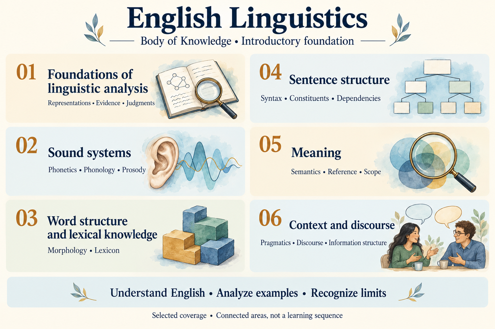

# English linguistics foundations

## Key takeaway
Understand English through five kinds of self-contained knowledge, ten subsystem Models and their interfaces.

## Summary
This foundation contains **107 knowledge files**: 72 Concepts, 13 Principles, ten Models, six Methods and six Practices, plus 31 supporting Reference records. The package combines reusable explanations with a learning Practice that selects and connects them. It remains foundational and provisional, not a complete or independently reviewed grammar.

## Explore by subject



The [English Linguistics Body of Knowledge Outline](docs/body-of-knowledge-outline.md) defines ten named subjects, 84 subject topics and three shared foundations topics, with required understanding, intended capabilities, existing explanations and gaps. Start with the [complete topic outline](docs/body-of-knowledge-outline.md#overall-outline) or start with [Phonetics](docs/body-of-knowledge-outline.md#phonetics), [Phonology](docs/body-of-knowledge-outline.md#phonology) and [Prosody](docs/body-of-knowledge-outline.md#prosody). The illustration shows selected introductory coverage, not completed learning or the whole discipline.

Three detailed illustrations retain the subject names and show all topic labels: [Phonetics, Phonology and Prosody](docs/body-of-knowledge-outline.md#sound-systems-illustration), [Morphology, Lexicon, Syntax and shared foundations](docs/body-of-knowledge-outline.md#foundations-and-structure-illustration), and [Semantics, Pragmatics, Discourse and Information Structure](docs/body-of-knowledge-outline.md#meaning-and-context-illustration). They are embedded beside the relevant coverage tables.

## Learn through a Practice

[Learn English linguistics](practices/learn-english-linguistics.md) provides the target learning route and one complete sound-analysis exercise: a worked comparison, a new case, feedback and explicit evidence limits. Definitions and Models are explained again where the task needs them. The other learning areas are an outline for further units; no learner outcomes are claimed.

[Edit English and learn from revisions](practices/edit-english-and-learn.md) applies the knowledge to writing: correct a verb form, clarify an ambiguous attachment, and offer an optional tone change. Three constructed cases explain the decisions and when to retain the original.

## Start with an explanation
[One passage across ten domains](methods/analyze-complete-utterance.md#one-passage-across-ten-domains) analyzes *Those students repaired the printers. They tested them again.* It distinguishes word forms, clause functions, semantic participants, contextual reference, discourse connections, focus and possible pronunciation. No recording was supplied, so its phonetic observations remain unknown rather than invented.

[English system architecture](docs/body-of-knowledge-outline.md#representations-across-subjects) explains the overall separation of representations. A subsystem Model can be read independently: it contains definitions, structure, an example, interface explanations, checks and limits. Links offer additional detail, not missing instructions.

## Ten subsystem Models

| Area | Its central distinction | Self contained Model |
|---|---|---|
| Phonetics | Speech production, physical signal and perception are distinct descriptions | [Phonetics](models/english-phonetics-system.md) |
| Phonology | Contrastive categories differ from contextually distributed realizations | [Phonology](models/english-phonology-system.md) |
| Morphology | Lexical identity, grammatical form and internal word structure differ | [Morphology](models/english-morphology-system.md) |
| Lexicon | A lexical entry relates forms, senses and constructional possibilities | [Lexicon](models/english-lexicon-system.md) |
| Syntax | Category, constituent structure and grammatical function are separate | [Syntax](models/english-syntax-system.md) |
| Semantics | Fixed interpretations and scope determine what follows logically | [Semantics](models/english-semantics-system.md) |
| Pragmatics | Contextual resolution, background and conversational inference differ | [Pragmatics](models/english-pragmatics-system.md) |
| Discourse | Referent tracking and coherence relate clauses and turns | [Discourse](models/english-discourse-system.md) |
| Information Structure | Topic, focus, givenness and current issues need separate labels | [Information Structure](models/english-information-structure-system.md) |
| Prosody | Stress, prominence, phrasing and realization interact without being identical | [Prosody](models/english-prosody-system.md) |

These areas overlap; their order here is neither a curriculum nor a language-processing pipeline. Interface sections inside the connected Models explain bounded correspondences, including Morphology–Phonology, Lexicon–Syntax, Syntax–Semantics, Semantics–Pragmatics, Pragmatics–Discourse, Information Structure–Prosody and Prosody–Phonetics.

## Organization
- `concepts/` defines reusable distinctions; `principles/` explains scoped relationships.
- `models/` contains actual representations, one self-contained Model per subsystem with its component and interface explanations.
- `methods/` gives bounded operations; `practices/` combines operations with local decisions and fallbacks.
- `references/` records external publications, inspected contributions and nonclaims. It is not a sixth knowledge role.

Markdown is canonical. No ontology registry, sequence store, entity database, generated knowledge views or build service is required to read this package. The [knowledge index](docs/INDEX.md) provides local summaries by role; it does not replace the Models. [Review priorities](docs/REVIEW.md#priority-evidence-gaps) track unresolved evidence work.

## Apply the knowledge
For an actual analysis, preserve the expression and context, identify complete constituents, separate grammatical functions from semantic roles, state unresolved references, and mark sound claims as predictions until audio is inspected. [Analyze complete utterance](methods/analyze-complete-utterance.md) gives the procedure. [Learn a word pronunciation](practices/learn-word-pronunciation.md) and [Classify and produce a phone](practices/classify-and-produce-phone.md) retain their locally usable stages and blank learner records.

## Evidence and pronunciation
General American remains the primary variety for new pronunciation analyses. Broad phonemic forms, predicted realizations and observed tokens are different kinds of claim. Read [PRONUNCIATION](docs/PRONUNCIATION.md) for notation and source-rights limits.

Every linguistic object remains provisional. Selected source inspection does not validate every sentence in a file. Constructed examples are not corpus data, and successful tests do not establish truth or learning outcomes.

## Authoring and checks

Reading requires no scripts. Maintainer guidance lives in `docs/`; [Checks](docs/CHECKS.md) explains the retained tools and document moves. The authored body of knowledge outline lives in `docs/body-of-knowledge-outline.md`; the optional generated role index lives in `docs/INDEX.md`. Authoring and pronunciation guidance are alongside them.
The package follows the upstream [Knowledge Practice System](https://github.com/xiongxianfei/knowledge-practice-system) KPS 9.x contract. English package version 0.2.0 is independent of upstream Core 11.0.0; the copied structural checker is 9.1.0. See [AUTHORING](docs/AUTHORING.md) and [COMPATIBILITY](docs/COMPATIBILITY.md).

```bash
python3 validate.py .
python3 -m unittest discover -s tests -v
python3 tools/check_domain.py
python3 tools/build_navigation.py --check
```

No third-party Python packages are required. For changes, edit Markdown, review affected summaries, run checks and open one PR. No automatic merge, release, remote materialization or publication service is needed. The [license](LICENSE) covers original material; external publications retain their own rights.
