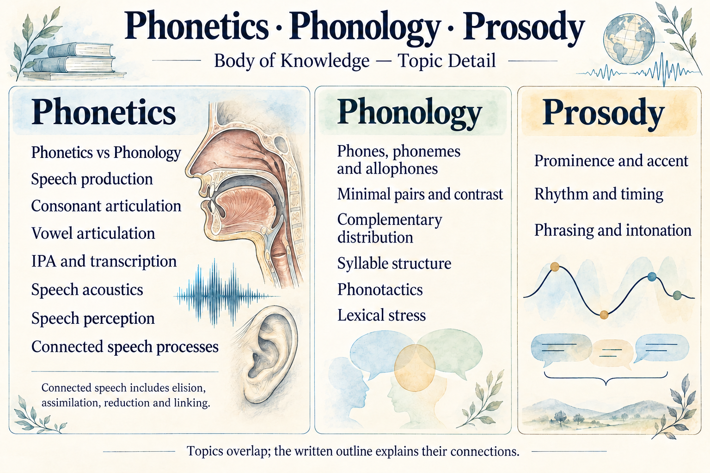
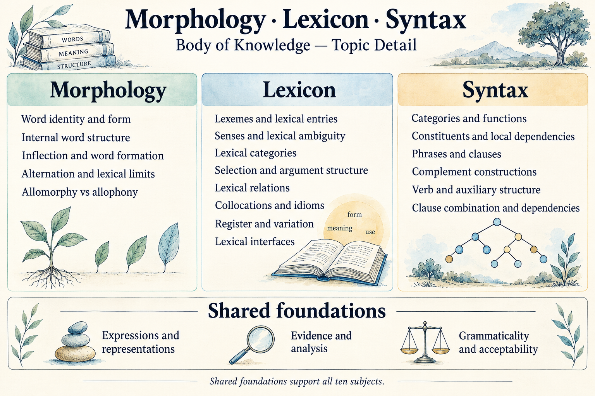
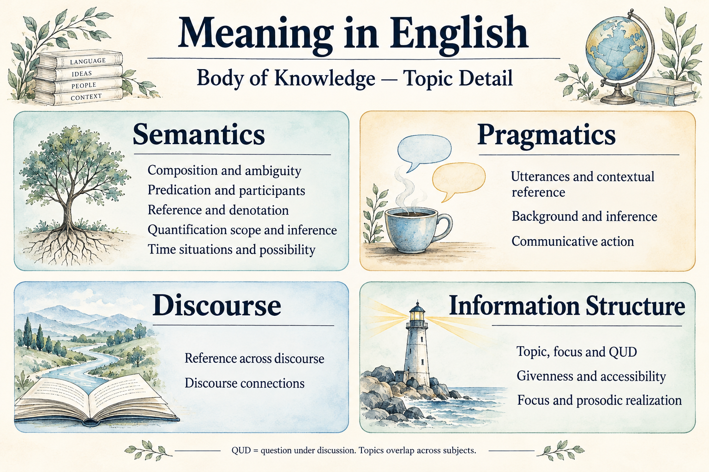

# English Linguistics Body of Knowledge Outline

## Key takeaway

Understand English through Phonetics, Phonology, Morphology, Lexicon, Syntax, Semantics, Pragmatics, Discourse, Information Structure and Prosody. Define the knowledge and analytical capabilities needed at introductory depth, then use existing explanations with their evidence limits visible.

## Summary

This outline specifies selected introductory coverage across ten named subjects and 53 subject topics, supported by three introductory foundations topics. It reuses established linguistic distinctions and the source contributions recorded below; the selected topic placement and capability targets are authored choices for this package. They are not a universal taxonomy, a processing pipeline or a compulsory learning sequence.

The package contains 107 knowledge objects and twenty-two Reference records. Their presence does not establish complete coverage or independent linguistic review. Concepts, Principles, Models, Methods and Practices retain their primary roles and may support more than one topic.

## Purpose and scope

**Target:** help an independent learner explain English structures, analyze bounded examples, compare plausible interpretations and recognize where a claim needs stronger evidence.

The intended depth is introductory analytical competence: explain a distinction, annotate a simple example, justify a proposed relationship and identify uncertainty. Basic familiarity with English is assumed; IPA, grammatical terminology and analytical notation are part of the required knowledge, not assumed prior mastery.

New pronunciation examples follow the package's declared General American convention. Source-specific Canadian or other accent examples keep their labels. Working syntax and semantic representations are framework-dependent; the [scope and theory policy](SCOPE.md) records their choices and the [pronunciation policy](PRONUNCIATION.md) defines notation limits.

This edition focuses on linguistic structure and interpretation. Sociolinguistic variation, historical change, language acquisition, psycholinguistic processing and corpus or experimental methods are broader subject areas deferred beyond this foundation. They remain relevant to English linguistics; their exclusion here does not imply that these ten subjects exhaust the discipline. Acoustic and perceptual investigation is introductory, and token-specific sound claims require actual evidence.

## Overall illustration

This original AI-generated overview keeps each subject name visible. Placement is for navigation, not learning order or a processing pipeline. The decorative motifs are not observations or formal analyses. [Saved generation prompt](../diagrams/body-of-knowledge-overview.prompt.txt).

Three detailed views show all 53 subject topics and three foundations topics: [Phonetics, Phonology and Prosody](#sound-systems-illustration); [Morphology, Lexicon, Syntax and shared foundations](#foundations-and-structure-illustration); and [Semantics, Pragmatics, Discourse and Information Structure](#meaning-and-context-illustration). Their grouping is only a page-layout choice; each subject retains its own heading and coverage section.

## Overall outline

[Shared foundations](#shared-foundations) introduce Expressions and representations; Evidence and analysis; Grammaticality and acceptability. They apply throughout, rather than forming an eleventh subject.

| Subject | Topics to cover | Subsystem Model |
|---|---|---|
| 1. [Phonetics](#phonetics) | Phonetics vs Phonology; Speech production; Consonant articulation; Vowel articulation; IPA and transcription; Speech acoustics; Speech perception; Connected speech processes | [Phonetics](../models/english-phonetics-system.md) |
| 2. [Phonology](#phonology) | Phones, phonemes and allophones; Minimal pairs and contrast; Complementary distribution; Syllable structure; Phonotactics; Lexical stress | [Phonology](../models/english-phonology-system.md) |
| 3. [Morphology](#morphology) | Word identity and form; Internal word structure; Inflection and word formation; Alternation and lexical limits; Allomorphy vs allophony | [Morphology](../models/english-morphology-system.md) |
| 4. [Lexicon](#lexicon) | Lexical entries and senses; Selection and arguments | [Lexicon](../models/english-lexicon-system.md) |
| 5. [Syntax](#syntax) | Categories and functions; Constituents and local dependencies; Phrases and clauses; Complement constructions; Verb and auxiliary structure; Clause combination and dependencies | [Syntax](../models/english-syntax-system.md) |
| 6. [Semantics](#semantics) | Composition and ambiguity; Predication and participants; Reference and denotation; Quantification scope and inference; Time situations and possibility | [Semantics](../models/english-semantics-system.md) |
| 7. [Pragmatics](#pragmatics) | Sentence meaning vs speaker meaning; Context; Deixis; Reference in context; Presupposition; Entailment vs presupposition vs implicature; Conversational implicature; Gricean reasoning; Speech acts; Direct vs indirect speech acts; Common ground; Information structure and discourse context; Semantics–Pragmatics interface | [Pragmatics](../models/english-pragmatics-system.md) |
| 8. [Discourse](#discourse) | Reference across discourse; Discourse connections | [Discourse](../models/english-discourse-system.md) |
| 9. [Information Structure](#information-structure) | Topic, focus and QUD; Givenness and accessibility; Focus and prosodic realization | [Information Structure](../models/english-information-structure-system.md) |
| 10. [Prosody](#prosody) | Prominence and accent; Rhythm and timing; Phrasing and intonation | [Prosody](../models/english-prosody-system.md) |

Each subject has one self-contained subsystem Model. Component explanations and interfaces are sections within these ten Models; Methods and Practices supply procedures and learning routes.

Subject boundaries are useful perspectives, not disjoint boxes. The table gives each topic a primary navigation location; the coverage sections and [connections](#connections-across-subjects) identify shared concerns. Prosody and Information Structure remain visible even though accounts often study them across other areas.

## Reading the coverage tables

**Understand** names the required knowledge; **Be able to do** sets intended introductory depth. These are coverage goals, not recorded learner outcomes. **Partial** means local explanations contribute but leave a stated gap. In this edition every row remains partial: source support, analytical breadth or usable examples are incomplete. No draft is promoted to reviewed science by its inclusion here.

Topic links identify existing support. Learning routes remain in Practices and development planning remains outside this outline. The [knowledge index](INDEX.md) lists files by role; it does not determine the required subject coverage.

## Shared foundations

These introductory distinctions support all ten subjects. The current foundational Concepts remain provisional, with external support pending where stated. Their labels also appear in the [foundations and structure illustration](#foundations-and-structure-illustration).

| Topic | Understand — required knowledge | Be able to do — introductory depth | Existing explanations and gaps |
|---|---|---|---|
| Expressions and representations | Expressions, analytical descriptions and levels of representation | Distinguish a written expression, a proposed grammatical analysis and a predicted or observed sound realization. | **Partial:** [Expression and representation](../concepts/expression-and-representation.md), [representation levels](../concepts/representation-levels.md). The general Concept’s claim-specific external support remains pending. |
| Evidence and analysis | Observations, constructed examples, analyses, predictions and counterevidence | State what supports a claim, identify missing data and keep an interpretation distinct from an observation. | **Partial:** [Evidence and analysis](../concepts/evidence-and-analysis.md), [evaluate a linguistic claim](../methods/evaluate-linguistic-claim.md). Dedicated source attachment and actual data-based demonstrations remain incomplete. |
| Grammaticality and acceptability | Licensing in a stated grammar or variety versus judgments made in a task and context | Separate a grammatical claim from an acceptability judgment and state the variety, context and evidence limits. | **Partial:** [Grammaticality and acceptability](../concepts/grammaticality-and-acceptability.md). External support and elicited judgment evidence remain pending. |

## Phonetics

[Phonetics](../models/english-phonetics-system.md) concerns speech production, physical signals and perception. The eight topics connect production, articulation, notation, acoustics and perception. Recorded and experimental investigation remains limited. Connected speech is placed here for its physical realizations, with [Phonology](#phonology) covering conditioned patterns and [Prosody](#prosody) contributing prominence and timing.

### Sound systems illustration

This view covers [Phonetics](#phonetics), [Phonology](#phonology) and [Prosody](#prosody). Connected speech includes coarticulation, assimilation, reduction, elision and linking; its conditioning also crosses these subjects. This original AI-generated artwork uses decorative motifs, not observed data or formal analyses. [Saved generation prompt](../diagrams/body-of-knowledge-sound-systems.prompt.txt).

### Phonetics coverage

| Topic | Understand — required knowledge | Be able to do — introductory depth | Existing explanations and gaps |
|---|---|---|---|
| Phonetics vs Phonology | Physical production, signals and perception versus language-specific sound organization | Separate a physical difference from a phoneme or allophone claim in a stated variety. | **Partial:** [Phonetics vs Phonology](../models/english-phonetics-system.md#phonetics-vs-phonology); [Representation levels](../concepts/representation-levels.md). The distinction and interfaces are explained; broader contrast data and independent review remain absent. |
| Speech production | Respiration, laryngeal activity, constrictions, oral and nasal airflow | Explain how coordinated mechanisms can produce different sounds despite a shared lip position. | **Partial:** [Speech production](../models/english-phonetics-system.md#speech-production). Selected production text supports the mechanism; no articulatory observation or complete anatomical account. |
| Consonant articulation | Voicing, place, manner and their physical meanings | Describe selected consonants and explain how changing one property changes the comparison. | **Partial:** [Consonant articulation](../models/english-phonetics-system.md#consonant-articulation); [Consonant articulation definition](../concepts/consonant-articulation.md). Local attribute tables retained; full accent-specific inventory and observed production remain incomplete. |
| Vowel articulation | Height, backness, rounding, changing quality and additional features | Compare vowel qualities without confusing tongue height with pitch or category labels with measurements. | **Partial:** [Vowel articulation](../models/english-phonetics-system.md#vowel-articulation); [Vowel articulation definition](../concepts/vowel-articulation.md). Selected attributes and examples available; complete inventories and measured formant comparisons remain missing. |
| IPA and transcription | Symbols, diacritics, phonemic versus phonetic notation and degrees of detail | Read a supported transcription and state its variety, purpose and evidence basis. | **Partial:** [IPA and transcription](../models/english-phonetics-system.md#ipa-and-transcription); [Representation levels](../concepts/representation-levels.md). Notation explained locally; original audio-based transcription and speaker comparisons remain missing. |
| Speech acoustics | Source and filter, F0, harmonics, formants, duration, intensity, signal views and VOT | Explain what a signal view represents; calculate a stated timing interval without inferring a category or perception automatically. | **Partial:** [Speech acoustics](../models/english-phonetics-system.md#speech-acoustics). Selected source support and synthetic timing example; no recording measurements or calibrated acoustic investigation. |
| Speech perception | Acoustic cues, identification, discrimination and limits of categorical-perception claims | Separate a measured acoustic difference from a question about listener categorization. | **Partial:** [Speech perception](../models/english-phonetics-system.md#speech-perception). Selected lecture support; no perceptual responses, listening lesson or complete hearing model. |
| Connected speech processes | Coarticulation, assimilation, reduction, elision and linking | Distinguish processes and specify evidence needed to decide between deletion and weak or overlapping cues. | **Partial:** [Connected speech processes](../models/english-phonetics-system.md#connected-speech-processes); [Connected speech definition](../concepts/connected-speech.md). Inline examples retained; Concept source attachment and observed speech remain incomplete. |

The [integrated sound comparison](../models/english-phonetics-system.md#connecting-the-whole-analysis) connects these topics inside one Phonetics Model. Anderson 2.1 and 2.6–2.7 support selected production and articulation distinctions, 3.1 transcription, and 3.4–3.8 selected processes and suprasegmentals. IPA records support notation, not a complete English inventory. Coleman supports source/filter distinctions; the Praat manual supports spectrogram interpretation; Flemming supports selected perception distinctions. These sources do not supply measurements or listener responses for the constructed examples. The [notation policy](PRONUNCIATION.md) and [Phonology interface](../models/english-phonology-system.md#interface-with-phonetics) retain variety and category limits.

## Phonology

[Phonology](../models/english-phonology-system.md) concerns language-specific contrast, distribution and sound organization. Phones and allophones connect this account to [Phonetics](#phonetics). Lexical stress is introduced here and revisited under [Prosody](#prosody); this placement does not make stress exclusive to one subject.

The topics below appear in the [detailed illustration](#sound-systems-illustration) under their subject name.

### Phonology coverage

| Topic | Understand — required knowledge | Be able to do — introductory depth | Existing explanations and gaps |
|---|---|---|---|
| Phones, phonemes and allophones | Phonetic segments, contrastive categories and their variants; connects sound description with a phonological analysis | Classify a proposed sound description as a phone, phoneme or allophone analysis and state the evidence required. | **Partial:** [Phone phoneme and allophone](../concepts/phone-phoneme-and-allophone.md), [realization and environment](../principles/realization-varies-with-environment.md). Broader distribution data and independent review remain absent. |
| Minimal pairs and contrast | Matched sound comparisons that distinguish lexical identity; connects examples with proposed phoneme contrasts | Use a matched word comparison to argue for a contrast in a specified variety and state the comparison’s limitations. | **Partial:** [Contrast and distribution](../concepts/contrast-and-distribution.md), [Phonology worked example](../models/english-phonology-system.md#worked-example). Dedicated source attachment for the Concept and broader lexical evidence remain incomplete. |
| Complementary distribution | Nonoverlapping environments and their possible relevance to allophony; distribution requires interpretation and does not alone establish phoneme identity | Compare environments and explain why nonoverlap alone is insufficient to establish an allophonic analysis. | **Partial:** [Contrast and distribution](../concepts/contrast-and-distribution.md), [phone phoneme and allophone](../concepts/phone-phoneme-and-allophone.md). Source-grounded distribution datasets and alternative analyses remain needed. |
| Syllable structure | Onset, nucleus and coda in the working representation; connects segment grouping with stress and sound environments | Label onset, nucleus and coda in a simple working analysis and explain uncertainty in an ambiguous boundary. | **Partial:** [Syllable structure](../concepts/syllable-structure.md), [phonological word](../models/english-phonology-system.md#phonological-word). Dedicated structural source support and analysis of competing syllabifications remain incomplete. |
| Phonotactics | Restrictions and preferences on sound positions and combinations; distinguishes structural possibility from the existence of a word | Distinguish a proposed constraint, a preference and an accidental lexical gap for a named variety. | **Partial:** [Phonotactics](../concepts/phonotactics.md), [constraint and preference](../concepts/constraint-and-preference.md). Dedicated source inspection and contrastive distribution evidence remain missing. |
| Lexical stress | Prominence relations among syllables and their description; connects word organization with prosodic realization | Identify the proposed level of prominence and explain how lexical stress differs from utterance-level accent. | **Partial:** [Stress](../concepts/stress.md), [Phonology Prosody interface](../models/english-phonology-system.md#interface-with-prosody). Fuller lexical-stress examples and listening evidence remain needed. |

Anderson 4.1 supports selected contrast distinctions and 4.4 natural classes. Dedicated source attachment for the contrast/distribution Concept, syllable structure and phonotactics remains incomplete. See [allomorphy vs allophony](#morphology) for the morphology interface and [conditioned connected-speech patterns](../models/english-phonology-system.md#connected-speech-patterns) for overlap with phonetics. Related Model citations do not automatically close a Concept's source gap.

## Morphology

[Morphology](../models/english-morphology-system.md) explains internal word structure and grammatical forms. Word identity, lexicalization and productivity overlap with [Lexicon](#lexicon); allomorphy connects with [Phonology](#phonology). The interface comparison below preserves the distinction between morpheme forms and sound-category realizations.

### Foundations and structure illustration

This view covers [Morphology](#morphology), [Lexicon](#lexicon), [Syntax](#syntax) and [shared foundations](#shared-foundations). Foundations support every subject, including those pictured in the other views. This original AI-generated artwork uses decorative motifs, not observed data or formal analyses. [Saved generation prompt](../diagrams/body-of-knowledge-foundations-and-structure.prompt.txt).

### Morphology coverage

| Topic | Understand — required knowledge | Be able to do — introductory depth | Existing explanations and gaps |
|---|---|---|---|
| Word identity and form | Lexemes, word forms, paradigms and syncretism | Distinguish a lexeme from a word form and compare a small paradigm without treating identical forms as identical grammatical analyses. | **Partial:** [Lexeme and word form](../concepts/lexeme-and-word-form.md), [paradigm and syncretism](../concepts/paradigm-and-syncretism.md). Paradigm and syncretism explanations need fuller claim-specific source support. |
| Internal word structure | Morphemes, roots, bases, stems, affixes and structural alternatives | Segment a transparent example and justify a proposed root, base, stem and affix structure, marking ambiguous analyses. | **Partial:** [Morpheme](../concepts/morpheme.md), [root base and stem](../concepts/root-base-and-stem.md), [affix](../concepts/affix.md), [word formation](../models/english-morphology-system.md#word-formation-hierarchy). Segmentation diagnostics and alternative structures need dedicated sources and broader examples. |
| Inflection and word formation | Grammatical inflection, derivation, compounding and their boundaries | Compare an inflectional pattern with derivation or compounding and identify a boundary case. | **Partial:** [Inflection](../concepts/inflection.md), [derivation](../concepts/derivation.md), [compounding](../concepts/compounding.md). Inspected inflection material does not supply full support for derivation, compounding or their boundaries. |
| Alternation and lexical limits | Allomorphy, suppletion, productivity and lexicalization | Compare conditioned variation, suppletion and lexicalized forms and state what would support a productivity claim. | **Partial:** [Allomorphy](../concepts/allomorphy.md), [suppletion](../concepts/suppletion.md), [productivity and lexicalization](../concepts/productivity-and-lexicalization.md). Allomorphy has selected source support; productivity, suppletion and lexicalization need fuller evidence. |
| Allomorphy vs allophony | Correspondences between grammatical word forms and sound patterns; distinguishes allomorphy from allophony | Explain why allomorphy concerns forms of a morpheme and allophony concerns realizations of a sound category. | **Partial:** [Allomorphy](../concepts/allomorphy.md), [Morphology Phonology interface](../models/english-morphology-system.md#interface-with-phonology), [sound-conditioned exponents](../principles/exponents-are-conditioned-by-sound.md). Dedicated source attachment for the interface and broader conditioned examples remain incomplete. |

Anderson's inspected 6.2 and 6.3 passages support selected allomorphy and inflection distinctions. Word forms connect to sounds through [Morphology Phonology](../models/english-morphology-system.md#interface-with-phonology) and to clause structure through [Morphology Syntax](../models/english-morphology-system.md#interface-with-syntax). Other entries retain their stated source limitations.

## Lexicon

[Lexicon](../models/english-lexicon-system.md) explains item-specific forms, senses and distribution. Its subject coverage includes the shared word identity and lexical limits introduced under [Morphology](#morphology). Sense distinctions connect to [Semantics](#semantics), and lexical selection connects to [Syntax](#syntax).

The topics below appear in the [detailed illustration](#foundations-and-structure-illustration) under their subject name.

### Lexicon coverage

| Topic | Understand — required knowledge | Be able to do — introductory depth | Existing explanations and gaps |
|---|---|---|---|
| Lexical entries and senses | Lexical form, sense distinctions, ambiguity and collocation | Draft a small sense-specific lexical description and distinguish lexical ambiguity from a contextual interpretation. | **Partial:** [Lexical entry](../concepts/lexical-entry.md), [sense and lexical ambiguity](../concepts/sense-and-lexical-ambiguity.md), [collocation](../concepts/collocation.md). Sense diagnostics, collocation evidence and corpus-based lexical descriptions remain incomplete. |
| Selection and arguments | Lexical selection, valency, argument structure and sense dependence | Compare the complements licensed by selected senses and explain why the analysis depends on sense and construction. | **Partial:** [Lexical selection](../concepts/lexical-selection.md), [valency and argument structure](../concepts/valency-and-argument-structure.md), [sense-sensitive selection](../principles/selection-is-sense-sensitive.md). Broader usage evidence and source support for competing argument-structure accounts remain needed. |

[Lexicon Syntax](../models/english-lexicon-system.md#interface-with-syntax) connects lexical senses and available constructions. Existing lexical entries and constructed contrasts do not supply a corpus-based inventory or settle competing lexical theories.

## Syntax

The [Syntax Model](../models/english-syntax-system.md) uses a declared working account of constituents and grammatical functions. A category such as noun phrase and a function such as Subject answer different questions.

The topics below appear in the [detailed illustration](#foundations-and-structure-illustration) under their subject name.

### Syntax coverage

| Topic | Understand — required knowledge | Be able to do — introductory depth | Existing explanations and gaps |
|---|---|---|---|
| Categories and functions | Word and phrase categories versus grammatical relations in a construction | Label an expression’s category separately from its grammatical function in a specified construction. | **Partial:** [Category and function](../concepts/category-and-function.md), [category does not determine function](../principles/category-does-not-determine-function.md). Broader construction comparisons and claim-specific source support remain incomplete. |
| Constituents and local dependencies | Constituency evidence, heads, dependents, complements and modifiers | Apply more than one grouping diagnostic and identify a local head-dependent relation without treating one test as decisive. | **Partial:** [Constituency](../concepts/constituency.md), [head and dependent](../concepts/head-and-dependent.md), [complement and modifier](../concepts/complement-and-modifier.md). Selected constituent and adjunct passages do not establish all diagnostics or analyses. |
| Phrases and clauses | Phrase and clause organization, nesting and framework choices | Identify phrase and clause spans in a short nested example and state the adopted structural framework. | **Partial:** [Phrase and clause](../concepts/phrase-and-clause.md), [clause architecture](../concepts/clause-architecture.md), [nested clause](../models/english-syntax-system.md#nested-clauses). Framework comparisons and support for all clause patterns remain incomplete. |
| Complement constructions | Objects, PP complements, predicative complements and complement clauses | Distinguish an object, PP complement, predicative complement and complement clause in selected examples. | **Partial:** [Object and PP complement](../concepts/object-and-pp-complement.md), [predicative complement](../concepts/predicative-complement.md), [complement clause](../concepts/complement-clause.md). Construction-specific sources and counterexamples remain needed. |
| Verb and auxiliary structure | Finiteness, auxiliary order and selection, inversion, negation and do-support | Analyze a short auxiliary chain and explain proposed finiteness, inversion, negation and do-support relationships. | **Partial:** [Finiteness](../concepts/finiteness.md), [auxiliary chain](../concepts/auxiliary-chain.md), [auxiliary selection](../models/english-syntax-system.md#auxiliary-selection), [do support and inversion](../concepts/do-support-and-inversion.md). The selection Model now has bounded source support for central-modal form selection and an inline correction example. Other construction claims require fuller external support and variety comparisons. |
| Clause combination and dependencies | Coordination, subordination, relative clauses and wh-dependencies | Distinguish coordination, subordination, relative modification and a wh-dependency in a bounded example. | **Partial:** [Coordination and subordination](../concepts/coordination-and-subordination.md), [relative clause](../concepts/relative-clause.md), [wh dependency](../concepts/wh-dependency.md). Dependency constraints, difficult boundary cases and competing frameworks remain incompletely supported. |

[Analyze constituency](../methods/analyze-constituency.md) supplies a procedure for investigating grouping. [Compare argument mappings](../methods/compare-argument-mappings.md) connects grammatical functions with the participant analysis under [Semantics](#semantics). Anderson 8.3, 8.8 and 9.3 provide selected support for constituents, adjuncts and function/role distinctions; this does not establish all linked constructions or require one universal syntactic framework.

## Semantics

The [Semantics Model](../models/english-semantics-system.md) connects expression interpretation with predicates, participants and operators. [Lexicon Semantics](../models/english-lexicon-system.md#interface-with-semantics) and [Syntax Semantics](../models/english-syntax-system.md#interface-with-semantics) connect this account to word senses and sentence structure.

### Meaning and context illustration

This view covers [Semantics](#semantics), [Pragmatics](#pragmatics), [Discourse](#discourse) and [Information Structure](#information-structure). No panel is a substitute for another subject or a processing stage. This original AI-generated artwork uses decorative motifs, not observed data or formal analyses. [Saved generation prompt](../diagrams/body-of-knowledge-meaning-and-context.prompt.txt).

### Semantics coverage

| Topic | Understand — required knowledge | Be able to do — introductory depth | Existing explanations and gaps |
|---|---|---|---|
| Composition and ambiguity | Compositional interpretation, lexical and structural ambiguity, and vagueness | Give two readings of a suitable ambiguous example and explain which lexical or structural difference supports them. | **Partial:** [Compositionality](../concepts/compositionality.md), [ambiguity and vagueness](../concepts/ambiguity-and-vagueness.md). The ambiguity Concept now has selected Anderson support for lexical/structural ambiguity and a worked attachment explanation. Broader compositional mechanisms, scope and vagueness diagnostics need further formal and empirical support. |
| Predication and participants | Semantic predicates, participant-role accounts and their distinction from grammatical functions | Identify a predicate and its proposed participant roles while keeping grammatical functions distinct. | **Partial:** [Semantic predicate](../concepts/semantic-predicate.md), [semantic role](../concepts/semantic-role.md), [functions and roles](../principles/functions-do-not-determine-roles.md). Selected passive material supports a distinction, not a universal inventory of roles. |
| Reference and denotation | Semantic values, reference and context-dependent resolution | Separate a proposed semantic value from the referent resolved in a stated context. | **Partial:** [Reference and denotation](../concepts/reference-and-denotation.md), [context supplies reference values](../principles/context-supplies-reference-values.md). The selected word-meaning source does not settle all reference or denotation theories. |
| Quantification scope and inference | Quantifiers, operator interaction, negation and entailment under stated assumptions | Compare two scope readings in a stated simple model and show how their entailments differ. | **Partial:** [Quantification and scope](../concepts/quantification-and-scope.md), [quantifier scope](../models/english-semantics-system.md#quantifier-scope), [negation and entailment](../concepts/negation-and-entailment.md). Formal examples are constructed; natural-language accessibility and broader inference patterns need evidence. |
| Time situations and possibility | Temporal location, aspectual perspective, situation types and modal alternatives | Distinguish tense, aspect, situation type and modality in a bounded example, preserving alternative readings. | **Partial:** [Tense and aspect](../concepts/tense-and-aspect.md), [situation type](../concepts/situation-type.md), [temporal reference](../models/english-semantics-system.md#temporal-reference), [modality](../concepts/modality.md). Temporal and modal representations remain provisional and do not exhaust the competing accounts. |

Anderson 9.1, 10.1 and 9.3 supply limited ambiguity, word-meaning and participant-role support. The scope and temporal Models are working analyses with their own assumptions. Contextual interpretation connects with [Pragmatics](#pragmatics); a source for a lexical distinction does not establish every formal semantic claim.

## Pragmatics

[Pragmatics](../models/english-pragmatics-system.md) concerns interpretation in use: contextual reference, shared assumptions, inference and communicative action. The boundaries with [Semantics](#semantics), [Discourse](#discourse) and [Information Structure](#information-structure) depend on the adopted account.

The topics below appear in the [detailed illustration](#meaning-and-context-illustration) under their subject name.

### Pragmatics coverage

| Topic | Understand — required knowledge | Be able to do — introductory depth | Existing explanations and gaps |
|---|---|---|---|
| Sentence meaning vs speaker meaning | Conventional contribution, situated utterance and intended communication | Separate what wording contributes from a proposed speaker intention. | **Partial:** [Sentence meaning vs speaker meaning](../models/english-pragmatics-system.md#sentence-meaning-vs-speaker-meaning); [Utterance and speaker meaning](../concepts/utterance-and-speaker-meaning.md). Selected teaching support; broader uses and observed intentions remain unverified. |
| Context | Participants, time, place, preceding discourse, current issue and shared assumptions | List the contextual values needed and preserve unresolved alternatives. | **Partial:** [Context](../models/english-pragmatics-system.md#context); [Contextual resolution](../concepts/contextual-resolution.md). The context representation is authored; no universal selection algorithm is established. |
| Deixis | Person, place and time anchoring; utterance occasion versus later report | Resolve a deictic expression under stated coordinates and explain what changes when they change. | **Partial:** [Deixis](../models/english-pragmatics-system.md#deixis); [Deixis definition](../concepts/deixis.md). Person reference has selected support; temporal and shifted-perspective cases need fuller review. |
| Reference in context | Situational and discourse reference, candidate referents and ambiguity | Justify a proposed referent or leave multiple candidates open. | **Partial:** [Reference in context](../models/english-pragmatics-system.md#reference-in-context); [Discourse referent](../concepts/discourse-referent.md). Introductory teaching support; no recorded reference-resolution outcomes. |
| Presupposition | Background, triggers, projection, accommodation and challenge | Compare a background condition across negation and embedding without treating projection as exceptionless. | **Partial:** [Presupposition](../models/english-pragmatics-system.md#presupposition); [Presupposition definition](../concepts/presupposition.md). Selected notes support the distinctions; broader trigger behavior and competing theories remain incomplete. |
| Entailment vs presupposition vs implicature | Truth-conditional consequence, background and defeasible communicated inference | Compare contradiction, projection, cancellation and background challenge on a stated reading. | **Partial:** [Entailment vs presupposition vs implicature](../models/english-pragmatics-system.md#entailment-vs-presupposition-vs-implicature); [Negation and entailment](../concepts/negation-and-entailment.md). Worked comparison available; the diagnostics do not form a universal classifier. |
| Conversational implicature | Communicated inferences, relevant alternatives and contextual dependence | Explain an inference and a context or continuation that weakens it. | **Partial:** [Conversational implicature](../models/english-pragmatics-system.md#conversational-implicature); [Conversational implicature definition](../concepts/implicature.md). Scalar case supported selectively; broader kinds and actual processing need evidence. |
| Gricean reasoning | Quantity, Quality, Relation, Manner and assumptions in a derivation | Derive a possible scalar inference and explain where relevance or limited knowledge blocks it. | **Partial:** [Gricean reasoning](../models/english-pragmatics-system.md#gricean-reasoning); [Gricean reasoning definition](../concepts/gricean-reasoning.md). Selected support for maxims and scalar reasoning; irony, deception and competing accounts need fuller treatment. |
| Speech acts | Locution, illocutionary force, effects and felicity conditions | Distinguish a proposed act from sentence form and its observed or unobserved outcome. | **Partial:** [Speech acts](../models/english-pragmatics-system.md#speech-acts); [Speech act](../concepts/speech-act.md). Introductory conditions available; no comprehensive taxonomy or interactional observations. |
| Direct vs indirect speech acts | Conventional form-associated force, indirect use and contextual evidence | Compare a direct request, an interrogative request and an ability question. | **Partial:** [Direct vs indirect speech acts](../models/english-pragmatics-system.md#direct-vs-indirect-speech-acts); [Speech act](../concepts/speech-act.md). Selected form/force support; no universal politeness ranking or fixed processing order. |
| Common ground | Mutual acceptance, private information, accommodation and disputed commitments | Track what is proposed, treated as shared or challenged without assuming it is objectively true. | **Partial:** [Common ground](../models/english-pragmatics-system.md#common-ground); [Common ground definition](../concepts/common-ground.md). Selected teaching support; full discourse-update and belief models remain outside scope. |
| Information structure and discourse context | Topic, focus, givenness and the question under discussion | Explain how a change of current question changes relevance and proposed focus. | **Partial:** [Information structure and discourse context](../models/english-pragmatics-system.md#information-structure-and-discourse-context); [Focus topic and QUD](../concepts/focus-topic-and-qud.md). Roberts remains abstract-only; the focus comparison is constructed and has no audio evidence. |
| Semantics–Pragmatics interface | Conventional constraints, contextual values and inferred content | Separate reference resolution from an additional inference and state the adopted theoretical boundary. | **Partial:** [Semantics–Pragmatics interface](../models/english-pragmatics-system.md#semantics-pragmatics-interface). Selected introductory support; alternative semantic and pragmatic theories remain incompletely compared. |

All thirteen topics have explanations inside the single Pragmatics Model. The [integrated conversation](../models/english-pragmatics-system.md#worked-analysis) connects their contributions; it is an authored example, not an observed exchange. Bhatt, Fox and Menendez-Benito, Gibson and the Edinburgh readings supply selected claim-specific support recorded below. Roberts remains abstract-only. Topic visibility and local explanations improve navigation without implying complete source support or independent review.

## Discourse

[Discourse](../models/english-discourse-system.md) concerns reference and relations across clauses and turns. Givenness overlaps with [Information Structure](#information-structure), and interpreting a relation uses contextual assumptions from [Pragmatics](#pragmatics).

The topics below appear in the [detailed illustration](#meaning-and-context-illustration) under their subject name.

### Discourse coverage

| Topic | Understand — required knowledge | Be able to do — introductory depth | Existing explanations and gaps |
|---|---|---|---|
| Reference across discourse | Discourse referents, anaphora, accessibility, givenness and bridging | Trace possible antecedents and explain where reference is unresolved or requires bridging information. | **Partial:** [Discourse referent](../concepts/discourse-referent.md), [anaphora and accessibility](../concepts/anaphora-and-accessibility.md), [givenness and bridging](../concepts/givenness-and-bridging.md). Accessibility and bridging accounts need broader evidence and competing-case comparisons. |
| Discourse connections | Cohesion, coherence and temporal, causal, evidential and contrastive relations | Separate an explicit cohesive link from an inferred coherence relation and justify a proposed span relation. | **Partial:** [Cohesion and coherence](../concepts/cohesion-and-coherence.md), [discourse relation](../concepts/discourse-relation.md), [temporal causal and evidential relations](../concepts/temporal-causal-and-evidential-relations.md), [contrast and concession](../concepts/contrast-and-concession.md). Selected RST definitions do not establish all relations or the correctness of each constructed analysis. |

[Trace discourse interpretation](../methods/trace-discourse-interpretation.md) connects reference tracking and proposed discourse relations. The RST record supports selected relation definitions, not every relation or the correctness of each constructed analysis.

## Information Structure

[Information Structure](../models/english-information-structure-system.md) concerns the organization of an utterance relative to its discourse context: topic, focus, givenness and the question being addressed. These are interacting dimensions. Their realization connects with [Syntax](#syntax) and [Prosody](#prosody).

The topics below appear in the [detailed illustration](#meaning-and-context-illustration) under their subject name.

### Information Structure coverage

| Topic | Understand — required knowledge | Be able to do — introductory depth | Existing explanations and gaps |
|---|---|---|---|
| Topic, focus and QUD | Topic, focus alternatives and the question under discussion in a stated account | Distinguish what an exchange is about, the question it addresses and the proposed focus span. | **Partial:** [Focus topic and QUD](../concepts/focus-topic-and-qud.md), [Information Structure Model](../models/english-information-structure-system.md). Roberts support is abstract-only; detailed source inspection and alternative framework comparisons remain needed. |
| Givenness and accessibility | Contextual accessibility, discourse-new information and inferable referents; givenness is distinct from focus | Explain how previously mentioned or inferable information can still be focused in a constructed context. | **Partial:** [Givenness and bridging](../concepts/givenness-and-bridging.md), [common ground](../concepts/common-ground.md). Dedicated source attachment and evidence for competing givenness accounts remain incomplete. |
| Focus and prosodic realization | Connections between a contextual focus span and possible prominence patterns | Compare two contextual focus spans that can share an accented word; avoid inferring focus from accent alone. | **Partial:** [Information Structure Prosody interface](../models/english-information-structure-system.md#interface-with-prosody), [accent and focus](../principles/accent-does-not-exhaust-focus.md). Roberts support remains abstract-only; detailed focus evidence and audio-context comparisons are absent. |

The Roberts record supplies abstract-level support for one QUD-based account, not detailed focus-projection evidence or a universal consensus. Givenness and focus remain distinct; an accented word need not exhaust the focus span. These coverage goals do not establish additional source support.

## Prosody

[Prosody](../models/english-prosody-system.md) concerns prominence, rhythm, phrasing and intonation. It spans phonological organization and phonetic realization, with links to syntax and information structure. [Lexical stress](#phonology) remains shared coverage.

The topics below appear in the [detailed illustration](#sound-systems-illustration) under their subject name.

### Prosody coverage

| Topic | Understand — required knowledge | Be able to do — introductory depth | Existing explanations and gaps |
|---|---|---|---|
| Prominence and accent | Utterance-level prominence and pitch accents, distinguished from lexical stress and acoustic peaks | Separate lexical stress, proposed pitch accent and a claim about physical realization in a simple analysis. | **Partial:** [Prosody and intonation](../concepts/prosody.md), [Prosody Model](../models/english-prosody-system.md), [Phonology Prosody interface](../models/english-phonology-system.md#interface-with-prosody). Only selected ToBI text was inspected; full annotation and recorded comparisons remain absent. |
| Rhythm and timing | Relative timing of prominent and less prominent material; stress does not imply perfectly equal intervals | Describe which duration comparisons would investigate a timing claim without inventing measurements or obligatory elision. | **Partial:** [Prosody Model](../models/english-prosody-system.md), [Prosody Phonetics interface](../models/english-prosody-system.md#interface-with-phonetics). Acoustic measurements, broader timing sources and observed speech examples remain missing. |
| Phrasing and intonation | Prosodic grouping, boundary cues and phrase-level pitch patterns in context | Distinguish an accent from a phrase boundary and explain why punctuation or a pitch rise alone does not settle phrasing or meaning. | **Partial:** [Prosody and intonation](../concepts/prosody.md), [Prosody Model](../models/english-prosody-system.md), [MIT ToBI record](../references/mit-2006-tobi-tutorial.md). Selected text support does not provide a complete annotation course, actual recordings or detailed focus evidence. |

Only selected MIT ToBI text and the recorded Anderson passages support this account. Full annotation, actual recordings, detailed focus evidence and complete accent inventories remain missing. [Prosody Phonetics](../models/english-prosody-system.md#interface-with-phonetics) connects proposed structures with variable physical cues; [Information Structure Prosody](../models/english-information-structure-system.md#interface-with-prosody) connects them with contextual interpretation.

## Connections across subjects

| Connection | Relationship to follow | Existing account |
|---|---|---|
| Speech description and sound organization | Physical realization and language-specific categories require different evidence | [Phonology Phonetics](../models/english-phonology-system.md#interface-with-phonetics) |
| Lexical stress and utterance prominence | Word-level stress and utterance-level accent interact but must remain distinct | [Phonology Prosody](../models/english-phonology-system.md#interface-with-prosody) |
| Word form and sound | A grammatical distinction can have differently conditioned realizations | [Morphology Phonology](../models/english-morphology-system.md#interface-with-phonology) |
| Lexical sense and construction | An item's sense and its available complements constrain an analysis together | [Lexicon Syntax](../models/english-lexicon-system.md#interface-with-syntax) |
| Grammatical function and participant role | The two descriptions must remain distinct when comparing constructions | [Syntax Semantics](../models/english-syntax-system.md#interface-with-semantics) |
| Conventional interpretation and context | Context supplies values and supports inferences with limits | [Semantics Pragmatics](../models/english-semantics-system.md#interface-with-pragmatics) |
| Discourse organization and prominence | The current issue relates to focus and possible prosodic realization | [Discourse Information Structure](../models/english-discourse-system.md#interface-with-information-structure), [Information Structure Prosody](../models/english-information-structure-system.md#interface-with-prosody) |

[English system architecture](#representations-across-subjects) explains the representations together. [One passage across ten domains](../methods/analyze-complete-utterance.md#one-passage-across-ten-domains) supplies an integrated example, and [Analyze complete utterance](../methods/analyze-complete-utterance.md) supplies an investigation procedure. These connections explain why some knowledge appears under more than one subject; they do not imply a fixed causal processing pipeline.

## Representations across subjects

English is documented here through distinct, interacting representations rather than a fixed processing staircase.

| System | Representation | Example question |
|---|---|---|
| Morphology | Lexemes and grammatical word forms | What does plural change? |
| Lexicon | Senses and selection | Which complements does this use permit? |
| Syntax | Constituent hierarchy and functions | What is inside the PP? |
| Semantics | Predicates and operators | What truth conditions and roles? |
| Pragmatics | Contextual interpretation | Which referent and intention? |
| Discourse | Referents and relations | How do utterances connect? |
| Information structure | Given status, Topic, Focus, QUD | Which alternatives matter? |
| Phonology | Segments, syllables and lexical stress | How are sound categories and patterns organized? |
| Prosody | Prominence, timing and phrasing | How is an utterance grouped and highlighted? |
| Phonetics | Articulation and acoustic realization | What was physically produced? |

Orthography is a writing representation, not a mandatory stage of speech processing. Interfaces are explained inside the connected subsystem Models.

The subsystem list is an authored documentation architecture, not a universally accepted taxonomy or a neural model. Two-way arrows mean possible constraint relations, not proof of symmetric direct causation among all pairs.

Check one complete example across levels. A proposed edge must name its source and target representations and explain a concrete mapping. Remove decorative arrows with no explanatory use; preserve genuine theoretical alternatives.

This organization is a provisional authored synthesis with claim-level external support still pending. The subsystem explanations preserve their own source limits.

## Source basis and selection

| Established account | Contribution to this outline | Boundary |
|---|---|---|
| [Anderson first edition](../references/anderson-2018-essentials-of-linguistics.md) | Selected accounts of articulation, transcription, contrast, sound processes, word forms, constituents and meaning | Only the recorded passages were inspected; Canadian examples do not define a full General American inventory |
| [Walter on modal forms](../references/walter-2016-modal-verbs-basics.md) | Following base forms in central-modal constructions | Narrow pedagogical support; not evidence for every auxiliary construction |
| [British Council grammar reference](../references/british-council-undated-grammar-reference.md) | Selected possibility and request constructions | No universal politeness ranking or interactional outcome established |
| [Official IPA chart](../references/international-phonetic-association-undated-ipa-chart.md) | Symbol categories and notation, including consonant and vowel dimensions | A chart does not specify an English phoneme inventory or a speaker's realization |
| [Coleman on speech acoustics](../references/coleman-undated-speech-acoustics.md) | Source/filter, harmonic and resonance distinctions | Selected HTML prose; no source audio or figure measurements |
| [Praat spectrogram manual](../references/praat-undated-spectrogram-manual.md) | Signal-view axes, shading and display limits | One manual section; no recording analyzed |
| [Flemming on speech perception](../references/flemming-2015-speech-perception.md) | Acoustic cues, identification and discrimination | Selected lecture text; underlying experiments not independently inspected |
| [MIT ToBI tutorial](../references/mit-2006-tobi-tutorial.md) | Selected distinctions between prominence, phrasing and tonal annotation | Selected PDF text only; no audio or complete ToBI course inspection |
| [Bhatt on implicature](../references/bhatt-2003-implicature.md) | Scalar alternatives, cancellation and the knowledge/relevance conditions on inference | Selected teaching account; no general processing algorithm |
| [Fox and Menendez-Benito on Pragmatics](../references/fox-menendez-benito-2006-pragmatics.md) | Context dependence versus conversational inference | Opening two pages; theoretical boundaries remain open |
| [Fox and Menendez-Benito on presupposition](../references/fox-menendez-benito-2006-presupposition.md) | Background, projection, accommodation and context update | Selected notes; no universal diagnostic or complete dialogue theory |
| [Gibson on pragmatic reference](../references/gibson-2017-pragmatic-reference.md) | Conversational maxims and shared versus privileged information | Selected slide text; research figures and underlying studies are not evidence for our examples |
| [Edinburgh pragmatic communication readings](../references/edinburgh-undated-pragmatic-communication.md) | Utterances, reference and direct/indirect speech acts | Selected teaching pages; original books and cited studies not separately inspected |
| [Roberts on information structure](../references/roberts-2012-information-structure.md) | A questions-under-discussion account connecting context, focus and prosody | Abstract-level support only; detailed focus analyses remain provisional |
| [Mann and Taboada RST introduction](../references/mann-taboada-undated-rst-introduction.md) | Named relations between discourse spans | Selected website definitions; the package uses an authored subset |

The Reference records identify the inspected passages. Selected modal-form, possibility, request and ambiguity explanations were inspected for the editing addition; no audio or learner inspection is claimed. In particular, the Roberts contribution remains abstract-only. The shared foundations introduction makes existing cross-cutting distinctions explicit; their local explanations still identify missing external support.

The ten subject headings reuse established linguistic names. Their equal navigation prominence, the primary placement of overlapping topics and this introductory scope are authored choices, not a taxonomy prescribed by one source. Prosody and Information Structure also span other subjects; making them visible does not claim universally exclusive or equally bounded subdisciplines. Required capabilities are authored goals. Source support for one distinction does not validate every linked example or claim. Useful overlap is retained between areas, including morphology–phonology and prosody–information structure.

## Maintaining the outline

Maintain this document as the single subject coverage guide. Keep the overall topic list, outcome rows, source limits and overall and detailed illustrations consistent when scope changes. A topic can remain necessary before a satisfactory explanation exists; a file link alone does not close its gap. Keep activity sequences in Practices and the file inventory in the generated index. No outline generator is needed.
